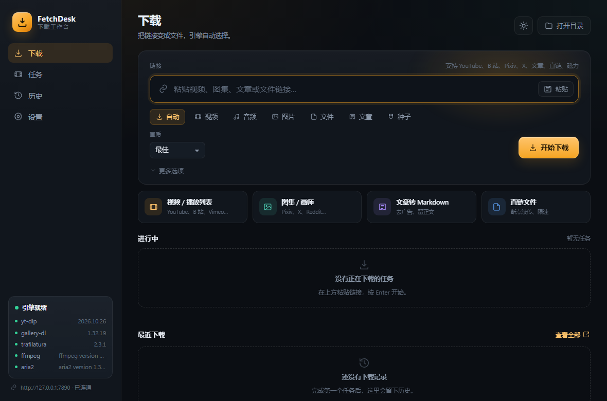
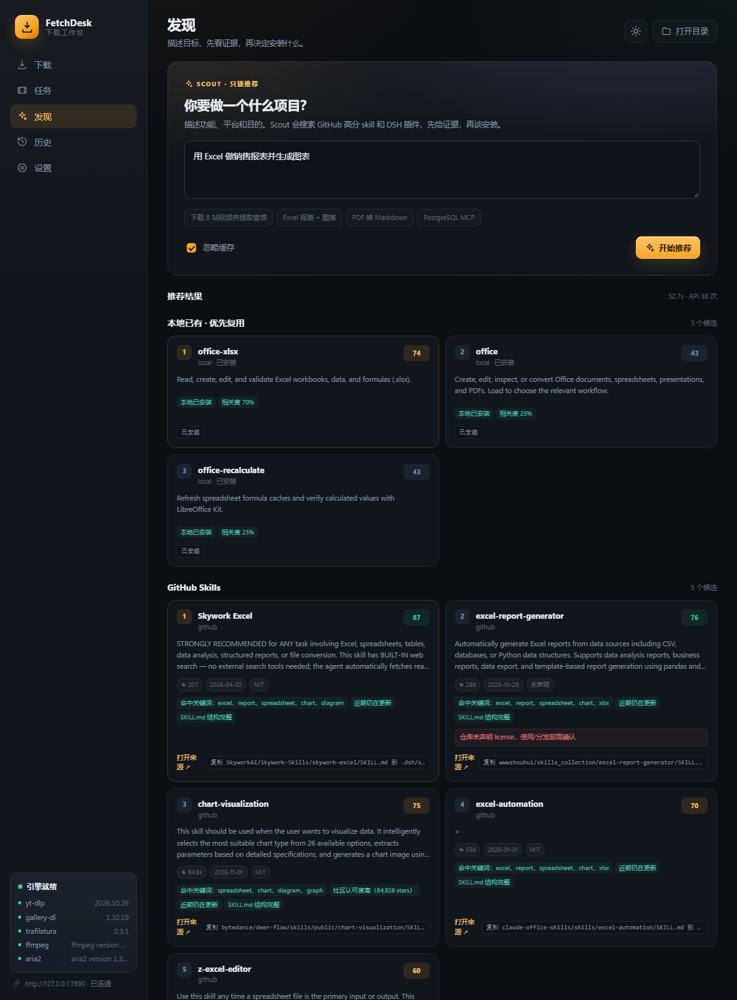

# 下载工作台（Windows）

这个项目把「给一个链接，快速、正确地保存到本地」做成了一条命令。它自动判断内容类型，选择最合适的引擎，复用本机代理，支持断点续传、去重归档和下载历史。

当前版本：**v2.0.2**（2026-11-02）。版本记录见 `CHANGELOG.md`，下一版规划见 `ROADMAP.md`。

## 从仓库重建

仓库不保存 `tools/` 里的二进制和 Python 包。新机器克隆后执行：

```bat
git clone https://github.com/Linxuans/universal_download.git download
cd download
powershell -ExecutionPolicy Bypass -File .\setup.ps1
```

只检查、不下载：

```bat
powershell -ExecutionPolicy Bypass -File .\setup.ps1 -Check
```

需要 Python 3.10+。脚本会把 yt-dlp / gallery-dl / trafilatura 装进 `tools\pylibs`，并下载 ffmpeg 与 aria2 到 `tools\`。代理默认 `127.0.0.1:7890`，用 `-Proxy` 或 `-NoProxy` 覆盖。

> Git 提示 `dubious ownership` 时（exFAT 不记录文件所有者），执行一次：
> `git config --global --add safe.directory F:/work/download`

## 版本管理

- 主分支 `main`；当前提交对应标签 `v2.0.2`。
- 每次可交付的迭代更新 `CHANGELOG.md` 并打语义化版本标签。
- 远程仓库：<https://github.com/Linxuans/universal_download>；规划见 `ROADMAP.md`。

## 已安装并验证

| 组件 | 版本 / 位置 | 用途 |
|---|---|---|
| yt-dlp | 2026.10.26 · `tools\pylibs` | 视频、音频、播放列表、直播回放、字幕 |
| gallery-dl | 1.32.19 · `tools\pylibs` | 图片站、画集、专辑、时间线 |
| trafilatura | 2.3.1 · `tools\pylibs` | 正文抽取，输出干净 Markdown |
| ffmpeg / ffprobe | N-128273 · `tools\ffmpeg\bin` | 合并音视频、转码、嵌入字幕/元数据 |
| aria2c | 1.37.0 · `tools\aria2` | HTTP 多线程、磁力/BT |
| Node.js | 系统已安装 | yt-dlp 的 YouTube `n` 挑战求解 |

`dl.cmd doctor` 会一次性检查以上全部内容、代理连通性和磁盘空间。

## 快速开始

在项目根目录 `F:\work\download` 打开终端：

```bat
dl.cmd doctor
dl.cmd "https://www.youtube.com/watch?v=..."
dl.cmd "https://en.wikipedia.org/wiki/Download"
```

第一条命令把内容下到 `downloads\YYYY-MM-DD\`，第二条自动识别为文章并保存为 Markdown。

## 桌面应用

双击桌面上的「下载工作台」，或运行：

```bat
gui.cmd
```

会打开一个独立的 Edge 应用窗口（没有地址栏），左侧是导航，中间是链接输入、类型、画质和高级选项，下方实时显示任务进度、日志、历史与设置。

在新机器上生成桌面快捷方式：

```bat
powershell -ExecutionPolicy Bypass -File .\scripts\create_shortcut.ps1
```

界面采用本地 HTML/CSS/JS + Edge `--app` 模式，下载逻辑仍由 Python 执行；关闭窗口即结束本次会话。桌面快捷方式指向 `pythonw.exe`，不会闪黑框。



### 指定类型

```bat
dl.cmd video   "https://www.bilibili.com/video/BV..." --quality 1080
dl.cmd audio   "https://www.youtube.com/watch?v=..." --audio-format m4a
dl.cmd images  "https://www.pixiv.net/artworks/..." --cookies --browser edge
dl.cmd file    "https://example.com/tool.zip"
dl.cmd article "https://example.com/blog/post"
dl.cmd torrent "magnet:?xt=urn:btih:..."
```

### 常用参数

| 参数 | 说明 |
|---|---|
| `--quality 1080` | 限制视频高度：`2160/1440/1080/720/480/best` |
| `--playlist` | 下载整个播放列表（默认只下当前条目） |
| `--cookies --browser edge` | 使用浏览器登录态（B 站高码率、X、Pixiv、Instagram 等） |
| `--cookie-file cookies.txt` | 使用导出的 Netscape cookies |
| `--subs` | 下载并嵌入中英文字幕 |
| `--audio-format m4a` | 音频容器：`mp3/m4a/opus/flac/wav` |
| `--out D:\Media` | 指定输出目录 |
| `--name lesson-01` | 重命名单个输出 |
| `--flat` | 不创建日期子目录 |
| `--force` | 忽略归档、覆盖重下 |
| `--dry-run` | 只显示将使用的引擎和目标目录 |
| `--json` | 输出机器可读的汇总 |
| `--limit-rate 2M` | 限速 |
| `--proxy ...` / `--no-proxy` | 覆盖代理 / 直连 |

批量下载：

```bat
dl.cmd get "https://a.example/1.zip" "https://b.example/2.zip" --flat
```

`--name` 只能用于单个链接。

## 发现（Scout）

在桌面版左侧点「发现」，用一句话描述你要做的项目、功能和目的，Scout 会搜索并排序：

1. **本地已有**：`.dsh/skills`、office 内置技能等，能复用就不重复安装。
2. **GitHub Skills**：仓库搜索 + `filename:SKILL.md` 代码搜索，读取 SKILL.md 原文。
3. **插件 / MCP**：DSH 插件目录（8,100+ 条）+ npm 补充；MCP 目标单独识别。

命令行同样可用：

```bat
scout.cmd advise "下载 B 站视频并提取音频" --save
scout.cmd skills "把 PDF 转成 Markdown" --limit 5
scout.cmd plugins "postgres mcp"
scout.cmd doctor
```

每项结果带：来源链接、分数、stars、更新时间、license、匹配理由、风险、安装/使用提示。`--json` 给自动化用，`--save` 写到 `reports\`。

**v2.0 是只读的**：Scout 不会安装、启用或执行任何推荐内容。插件的能力标注（`shell`、`fs-write`、`network`）会作为风险展示，安装前必须人工确认。

数据源：GitHub 仓库/代码搜索、SKILL.md 原文、`awesome-dsh-plugin.com/plugins.json`、npm registry。GitHub token 依次从 `GITHUB_TOKEN`、`.env`、Git Credential Manager 读取，只用于请求，不落盘、不回显。



## 目录结构

```text
F:\work\download\
├─ dl.cmd                         # 唯一入口（自动设置 PATH / PYTHONPATH）
├─ setup.ps1                      # 新机器一键重建依赖
├─ gui.cmd                        # 桌面版启动器（pythonw）
├─ scout.cmd                      # Scout CLI 启动器
├─ gui\                           # HTML/CSS/JS 界面与图标
├─ scripts\bootstrap.py           # setup.ps1 的实现（Python 标准库）
├─ scripts\gui.py                 # 本地 API + Edge 应用窗口
├─ scripts\scout.py               # Scout 搜索、评分与报告
├─ scripts\create_shortcut.ps1    # 生成桌面快捷方式
├─ requirements.txt               # Python 引擎版本下限
├─ config.json                    # 代理、下载根目录、命名模板
├─ config\gallery-dl.json         # gallery-dl 重试与断点配置
├─ .dsh\skills\download\
│  ├─ SKILL.md                    # DSH 技能说明（已被技能目录自动发现）
│  ├─ scripts\dl.py               # 路由器 + 下载器实现
│  └─ references\
│     ├─ sites.md                 # 各站点注意事项
│     └─ troubleshooting.md       # 故障排查
├─ .dsh\skills\scout\              # Scout 项目技能
├─ tests\                          # 离线单元测试
├─ tools\
│  ├─ pylibs\                     # yt-dlp / gallery-dl / trafilatura
│  ├─ ffmpeg\bin\                 # ffmpeg.exe / ffprobe.exe
│  └─ aria2\aria2c.exe
├─ state\                         # 归档、历史、缓存（不要提交）
├─ downloads\                     # 默认下载目录
├─ CHANGELOG.md                   # 版本记录
└─ ROADMAP.md                     # 下一版（skill/插件推荐器）规划
```

## 工作方式

### 自动路由

1. `magnet:`、`.torrent` → aria2。
2. 已知视频站 → yt-dlp；已知图片站 → gallery-dl。
3. 已知文件扩展名 → 文件下载；`.m3u8/.mpd` → yt-dlp。
4. 未知链接发一个 `HEAD`/范围请求，按 `Content-Type` 决定：HTML → 文章，图片/音视频 → 文件/视频，二进制 → 文件。
5. 探测失败时交给 yt-dlp 的通用提取器。

需要覆盖判断时用显式子命令（`video`/`images`/`article`/`file`/`torrent`）。

### 代理

优先级：`--proxy` > 环境变量 `HTTPS_PROXY/HTTP_PROXY` > `config.json` > Windows 系统代理。

默认 `http://127.0.0.1:7890`。`doctor` 会做 TCP 和 HTTP 204 双重检查；如果代理没开，会自动尝试系统代理，仍失败则直连。

### 断点、去重、历史

- 文件下载写 `.part`，重跑同一条命令会从断点继续；`--force` 才从零开始。
- yt-dlp 用 `state\ytdlp-archive.txt` 去重，gallery-dl 用 `state\gallery-archive.sqlite3` 去重。
- 每次尝试写入 `state\history.jsonl`：URL、模式、文件、字节数、耗时、错误。
- 文章 Markdown 带 `title/url/author/date/fetched` frontmatter，方便追溯来源。

### 两个 Windows 细节

- aria2 的 WinTLS 在当前受限令牌下无法初始化，因此 HTTPS 直链默认走 Python 断点下载，HTTP 才用 aria2 多线程；这是自动回退，不是错误。
- 工作盘是 exFAT，文件名会做 Windows 非法字符替换、保留名规避和 180 字节截断；中文文件名正常保留。

## 已验证的下载

| 场景 | 命令 | 结果 |
|---|---|---|
| YouTube 视频 | `video ... --quality 720` | 320×240 AV1，464 KB，4.8 s |
| YouTube 音频 | `audio ... --force` | MP3，324 KB，ffmpeg 转码成功 |
| 维基百科文章 | `article ...` | 12 KB Markdown，frontmatter 完整 |
| GitHub 原始文件 | `file ...README.md` | 174.9 KB，断点下载 |
| Wikimedia 图片 | `images ...png` | 219.3 KB，gallery-dl 成功 |
| HTTP 直链 | `file http://example.com` | aria2 577 B |
| 代理检查 | `doctor` | TCP OK / HTTP 204 |
| 桌面 UI | `gui.cmd` / 桌面快捷方式 | 本地 API、任务、进度、历史通过；Edge 窗口需普通桌面会话 |
| Scout | `scout.cmd advise "..."` | Excel 报表、PDF 转 Markdown、B 站下载均返回本地优先的推荐；只读 |

> 测试文件已清理，避免占用空间；命令和结果保留在此表中。

## 维护

```bat
dl.cmd update     # 升级 yt-dlp / gallery-dl / trafilatura
dl.cmd doctor     # 体检
```

- 升级包安装到 `tools\pylibs`，不污染系统 Python。
- ffmpeg 或 aria2 需要更换时，直接替换 `tools\ffmpeg\bin` / `tools\aria2\aria2c.exe`。
- 新增站点自动识别：编辑 `scripts\dl.py` 顶部的 `VIDEO_HOSTS` / `GALLERY_HOSTS`；不改也能用显式子命令。
- Scout 的权重与数据源见 `.dsh\skills\scout\references\scoring.md`；插件目录缓存 24 小时，`--refresh` 可强制刷新。

## 关于「排名靠前的 skill」

搭建前评估了当前 Agent Skills 生态里收藏较高的项目：

- [anthropics/skills](https://github.com/anthropics/skills)：官方 Agent Skills 规范与示例，作为 frontmatter/资源组织方式的基准。
- [michalparkola/tapestry-skills](https://github.com/michalparkola/tapestry-skills)：约 570★，包含 article-extractor、youtube-transcript 等下载相关技能；思路可借鉴，但实现以 bash/Unix 为主，直接搬到 Windows 会坏。
- [ranbot-ai/awesome-skills](https://github.com/ranbot-ai/awesome-skills)、[VoltAgent/awesome-agent-skills](https://github.com/VoltAgent/awesome-agent-skills)：用于交叉检索，没有找到同时覆盖「Windows + 代理 + 断点续传 + 多引擎」的通用下载技能。
- [BrikerMan/skilless.ai](https://github.com/BrikerMan/skilless.ai)：偏托管 API 的视频下载服务，引入外部付费依赖，不适合本地工作台。

结论：没有现成的高星技能能完整满足这个环境，因此按官方格式写了原生 `download` 技能，并把能力落在可测试的 CLI 上。技能已被 DSH 的技能目录自动发现（`/download` 可直接调用）。

## 安全与合规

- 只下载公开内容或你已获授权的内容；不绕过 DRM、付费墙和访问控制。
- Cookie 是登录凭证：只在用户同意后使用，不要粘贴到对话、提交到仓库或分享 `state\`。
- 遵守站点条款与速率限制；批量任务串行执行，避免触发风控。
- BT/磁力仅用于你有权获取的资源。

## 第三方组件许可

| 组件 | 许可 |
|---|---|
| yt-dlp | Unlicense |
| gallery-dl | GPL-2.0 |
| aria2 | GPL-2.0 |
| ffmpeg（BtbN gpl 构建） | GPL |
| trafilatura | Apache-2.0 |

各组件版权归其作者所有；本项目只做编排与 Windows 适配。